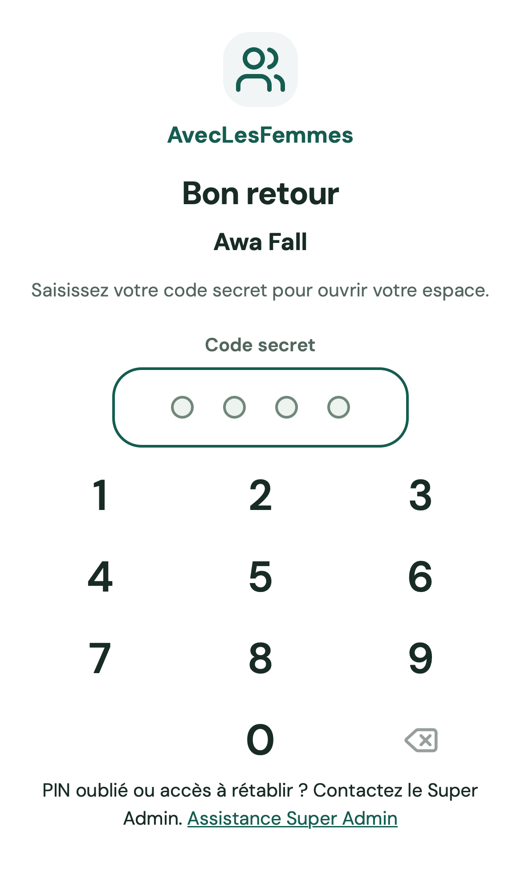
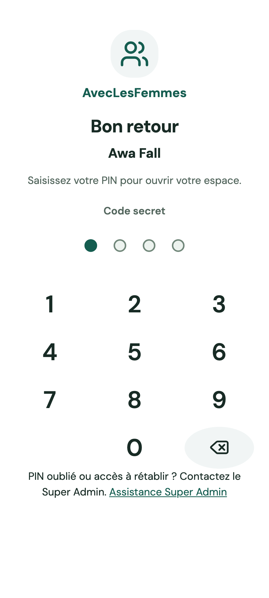
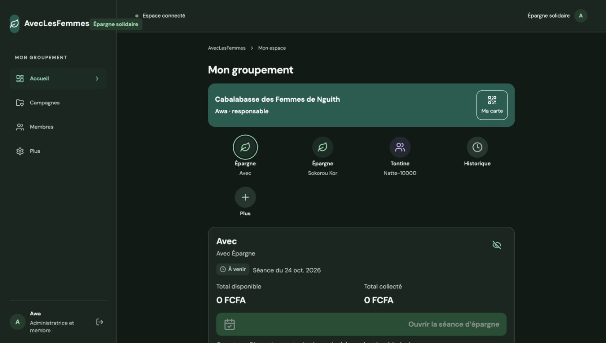

# Recette locale — Connexion PWA 1.1.0

24 octobre 2026. Branche `codex/pwa-acces-dates`. Modifications locales, publication distante non déclenchée.

## Parcours livré

- Première connexion : téléphone personnel, puis PIN existant ; aucun mot de passe demandé pour la connexion en ligne.
- Ouvertures suivantes sur l’appareil mémorisé : PIN seul. Verrouillage à l’ouverture, en arrière-plan et après cinq minutes conservé.
- Super Admin : connexion web inchangée, préparation ou remplacement d’un PIN personnel depuis la fiche membre, modification du téléphone global protégée. Les sessions et appareils précédents sont révoqués ; le mot de passe personnel reste inchangé.
- Hors ligne : activation volontaire et ouverture par mot de passe personnel ; le PIN ne déchiffre jamais le coffre. Conservation et récupération des brouillons lors d’une rotation d’appareil.

## Vérifications

- API : **54 tests réussis**, dont normalisation du téléphone, première connexion des deux profils, mot de passe personnel conservé, coffre protégé par appareil, blocage après cinq erreurs partagées, droits Super Admin, révocation et exclusion du Super Admin du parcours téléphone/PIN.
- Parcours mobiles ciblés : **26 tests réussis**, Chromium Android et WebKit iPhone, pour téléphone/PIN, retour par PIN seul, assistance administrative, dates mobiles, confirmation sensible et récupération d’un brouillon après renouvellement du PIN. Une seconde passe de **36 tests** couvre les thèmes, polices, verrouillage après cinq minutes, synchronisation automatique et scénarios hors ligne sur Android et iPhone.
- Calendrier et données de démonstration Nguith : test isolé réussi avec téléphone fictif normalisé ; aucune réinitialisation du jeu local.
- Versions SemVer : quatre tests réussis et six packages synchronisés en 1.1.0. Six tests de mise à jour PWA et de fiabilité des confirmations réussis.
- Vérification des types réussie pour les espaces PWA et Super Admin. Construction des quatre images Docker 1.1.0 réussie.

Les 124 tests de la recette complète ont été lancés dans l’environnement isolé ; 108 ont terminé avant la mise à jour des fixtures, puis les 16 scénarios concernés ont été relancés dans la passe ciblée de 36 tests, tous réussis.

## Données et environnement

Le téléphone fourni par la maîtrise d’ouvrage a été ajouté au compte local d’Awa et à son adhésion Nguith dans une transaction dédiée. Les empreintes du mot de passe et du PIN ont été comparées avant/après et sont identiques. Les trois campagnes et les données métier sont conservées. Le téléphone réel reste dans la base et la configuration locale privée ; les fixtures utilisent des numéros fictifs.

Application locale relancée : PWA `http://localhost:8086/`, Super Admin `http://localhost:8085/`, API `http://localhost:3005/`. PostgreSQL reste dans le volume Docker existant. Connexion d’Awa avec son PIN existant vérifiée dans Chrome sur la nouvelle version, accueil Nguith affiché. Les tests métier utilisent une base et des conteneurs jetables séparés.

## Limites

La première connexion téléphone/PIN est volontairement un seul facteur à quatre chiffres, selon [ADR 025](../../adr/025-connexion-telephone-pin.md). La preuve d’appareil n’est plus une condition préalable de ce nouveau parcours. Les anciens tests de refus sans preuve concernent exclusivement les routes historiques. L’audit de sécurité complet n’a pas été relancé ; les tests API et mobiles dédiés couvrent le nouveau fonctionnement.

Render n’a pas été modifié. La recette distante reste sur sa version précédemment publiée ; son téléphone et ses données n’ont pas été modifiés par cette recette locale.

## Captures

