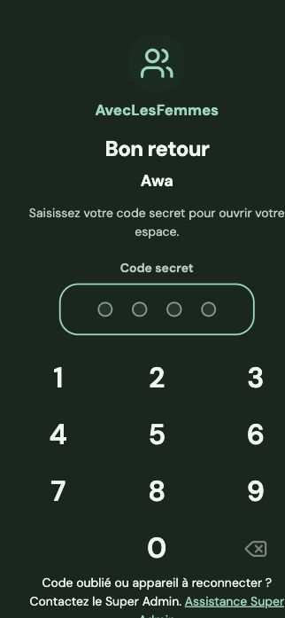

# Correctifs PWA 1.0.1 — vérification locale du 24 octobre 2026

Branche : `codex/pwa-acces-dates`, issue de la livraison 1.0.0. Aucun déploiement distant effectué. Données de Nguith conservées, aucune réinitialisation.

## Résultats

- Cohérence des versions, formatage et typecheck : réussis.
- Construction API, web et PWA : réussie ; images locales 1.0.1 construites.
- Tests API d’intégration : 50 réussis, dont le refus des profils membre/admin, des identifiants incorrects et la vérification qu’aucune session Super Admin n’est créée pour l’assistance.
- Tests mobiles ciblés connexion/code secret/historique : 22 réussis sur les images Docker finales, répartis entre Chromium et WebKit.
- Tests de versionnement : 4 réussis. Tests de mise à jour PWA : 4 réussis.
- Audit de sécurité isolé supplémentaire : non exécuté, autorisation d’exécution refusée. Les assertions de droits de l’oubli d’appareil ont été ajoutées pour la prochaine exécution autorisée ; ne pas présenter cet audit comme validé pour cette version.
- Vérification visuelle contre l’API et PostgreSQL locaux : connexion initiale d’Awa puis confirmation du code existant, groupement de Nguith et trois campagnes présents, historique consultable sans débordement, écran de retour au code sans les anciennes actions.
- Endpoint local `/api/v1/health/live` consulté dans Chrome : `status: ok`, `version: 1.0.1`.

Les tests de dates couvrent 320, 375, 390 et 498 px : contrôles dans l’écran, sans chevauchement, hauteur tactile, bornes min/max et transmission des paramètres `from` et `to`. Les tests simulés ne créent pas de versement réel. Les preuves visuelles ci-dessous proviennent du navigateur contre les données réelles locales.

## Captures

La publication distante reste conditionnée aux tests de livraison et à la consigne `VIZIODEPLOIE`.
